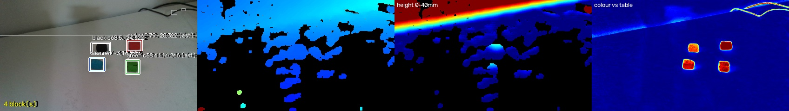

# Input and Pi-link bench test

A test build that logs exactly what the STM32 receives from the KY-023 joystick, the KY-040 encoder and
the Raspberry Pi (USART6). The numbers it gives (axis range, noise, counts per detent, round-trip time)
are the inputs for the servo / IK maths and object targeting. **Measure, don't guess.**

Nothing moves during this test: it needs motion and modes off, and the build stops with an `#error` if
they are on.

## 1. Enable the test

Create (or extend) `RoboticArmMain/App/common/app_config_local.h`. It is gitignored, never commit it:

```c
#pragma once
#define APP_INPUT_TEST  1     /* the bench log below */
#define APP_USE_MODES   0     /* required: no event consumer, nothing reacts to the stick */
#define APP_USE_MOTION  0     /* required: no servo PWM at all */
#define APP_USE_VOICE   0     /* optional: shorter loop, quieter log */
/* optional tunables (defaults shown):
#define APP_INPUT_TEST_FIND_MS  5000u         period of the test FIND
#define APP_INPUT_TEST_OBJ      OBJ_RED_BOX   object the test FIND asks for
#define APP_INPUT_TEST_CYCLE    0             1 = ask for all four objects in turn
#define APP_PI_TIMEOUT_MS       3000u         reply timeout under test
*/
```

The build prints the warning `app_config_local.h is active` (expected). Build and flash as usual in CubeIDE,
or headless:

```sh
# from the repo root; exit code 1 comes only from that expected warning, the .elf is built
PATH="<CubeIDE>/plugins/com.st.stm32cube.ide.mcu.externaltools.gnu-tools-for-stm32.<ver>/tools/bin:$PATH" \
  python3 ProjectDevGuide/ci/build_firmware.py --out build/input-test
STM32_Programmer_CLI -c port=SWD mode=UR -w build/input-test/RoboticArmMain.elf -v
STM32_Programmer_CLI -c port=SWD mode=HOTPLUG -rst
```

`STM32_Programmer_CLI` is inside CubeIDE (`plugins/com.st.stm32cube.ide.mcu.externaltools.cubeprogrammer.*/tools/bin`).
Read the log on the ST-LINK virtual COM port at **921600 8N1**. Before a pull request, delete the local file
(or move it aside) and run the three CI commands: CI never builds the test code path.

## 2. Wiring

Pins from [`core-config.md`](core-config.md) §3. KY-023 and KY-040 run from **3.3 V**, not 5 V.

| Part | Signal | STM32 pin | Nucleo header |
|---|---|---|---|
| KY-023 joystick | VRx | PA3 (ADC1_IN3) | CN9-1 (A0) |
| | VRy | PC0 (ADC1_IN10) | CN9-3 (A1) |
| | SW | PE15 (EXTI15, pull-up) | CN10-30 (D37) |
| | +5V pin | **3.3 V** | |
| | GND | GND | |
| KY-040 encoder | CLK | PE9 (TIM1_CH1) | CN10-4 (D6) |
| | DT | PE11 (TIM1_CH2) | CN10-6 (D5) |
| | SW | PE14 (EXTI14, pull-up) | CN10-28 (D38) |
| | + | **3.3 V** | |
| | GND | GND | |
| Pi link | STM32 TX → Pi GPIO15 RXD (pin 10) | PG14 (USART6_TX) | CN10-14 (D1) |
| | STM32 RX ← Pi GPIO14 TXD (pin 8) | PG9 (USART6_RX) | CN10-16 (D0) |
| | GND ↔ Pi GND (e.g. pin 6) | GND | |

Mounting used for the measured directions: **KY-023 with its pins pointing left** (as seen by the operator).
With that, `input.c` uses `JOY_X_SIGN +1`, `JOY_Y_SIGN -1`, `ENC_SIGN +1`, so **right, up (away from the
operator) and clockwise are positive**. A different mounting needs only these three signs changed.

First run of anything new: **servo signal wires disconnected**.

## 3. Raspberry Pi setup (once)

In `/boot/firmware/config.txt` (Raspberry Pi OS / Debian trixie; older images use `/boot/config.txt`):

```text
enable_uart=1
dtoverlay=disable-bt
```

Remove `console=serial0,115200` from `/boot/firmware/cmdline.txt`, reboot, then check
`ls -l /dev/serial0` → `ttyAMA0`. Your user must be in the `dialout` group (`id`).
pyserial is in the camera venv `~/arm-env` (`~/arm-env/bin/python -c "import serial"`).

## 4. Run the Pi script

`ProjectDevGuide/tools/pi/pilink_test.py`, copied to the Pi (e.g. `~/arm/tools/`). Stop
`pi_vision_uart.py` first: only one program can hold `/dev/serial0` (and the camera).

```sh
~/arm-env/bin/python ~/arm/tools/pilink_test.py                 # fake OBJ red_box 182 -45 30
~/arm-env/bin/python ~/arm/tools/pilink_test.py --xyz 200 0 25  # other fake position
~/arm-env/bin/python ~/arm/tools/pilink_test.py --realsense     # XYZ from the D435 pipeline
~/arm-env/bin/python ~/arm/tools/pilink_test.py --duration 60   # stop by itself
```

It answers every `FIND <name>` from the STM32. Keys (in a terminal, or one per line from a pipe):

| Key | Effect |
|---|---|
| `o` | reply `OBJ <name> x y z` (default) |
| `n` | reply `NOTFOUND <name>` |
| `s` | stay silent: the STM32 must log a timeout |
| `g` | send a garbage line now |
| `l` | send a 200-character line now |
| `q` | quit |

`--realsense` imports `BlockCamera`, `BlockDetector`, `load_refs()` and `best_per_color()` from
`~/arm/pi_vision_uart.py` without changing it. **Until `~/arm/calib_T.npy` exists, the values are
camera-frame mm, not robot-base mm** (the script prints which frame it sends). The team protocol
(robot-base frame, top-face centre, integer mm) needs that calibration; see `SETUP_PI.md` §9 on the Pi.
Only detections younger than `--max-age` (1 s) with confidence ≥ `--min-conf` (40) are sent, otherwise
`NOTFOUND`.

### The real bridge: `pi_bridge.py`

`ProjectDevGuide/tools/pi/pi_bridge.py` is the Pi side for real use: it answers every `FIND` from the
latest D435 detection (`OBJ <name> x y z` or `NOTFOUND <name>`) and sends nothing else. It uses the
same pipeline imports as `--realsense` above, the same `--max-age` / `--min-conf`, and `pi_vision_uart.py`
stays unchanged. Lines that are not a valid `FIND` are logged and ignored.

```sh
~/arm-env/bin/python ~/arm/tools/pi_bridge.py                          # needs ~/arm/calib_T.npy
~/arm-env/bin/python ~/arm/tools/pi_bridge.py --camera-frame --duration 60   # bench: camera-frame mm
```

It **refuses to start without `calib_T.npy`**, because the protocol is robot-base mm; `--camera-frame`
sends camera-frame mm until `calib_T.npy` appears (it is re-read while running, like `color_refs.json`).
Running it as a service, the log and debugging: [`inputs-and-pi-interface.md`](inputs-and-pi-interface.md) §3. The camera takes about 20 s to start (STM32 timeouts until then). It logs when
the camera stops delivering frames. One instance only: stop `pi_vision_uart.py` / `pilink_test.py` first.
Unit test of the line handling (no camera): `python3 ProjectDevGuide/tests/host/test_pi_bridge.py`.

## 5. What the STM32 logs

Format only: the numbers below are placeholders, not measurements.

Joystick, every 100 ms:
```text
joy: raw <x> <y> avg <x> <y> min-max <xmin>-<xmax> <ymin>-<ymax> out <x*1000> <y*1000> c
```
`raw` = one ADC conversion, `avg` = 10-sample mean (what `input_joy_x/y()` use), `min-max` = single
conversions in the last 100 ms (X, then Y), `out` = dead-zone output ×1000 (−1000…+1000), `c` = centred.

Every 2 s, over single conversions (use it for centre and noise at rest):
```text
joy: 2s X min <n> mean <n> max <n> pp <n> | Y min <n> mean <n> max <n> pp <n> | n <samples, 2000 at 1 kHz>
```

Encoder (only when it moved; raw counts, before `ENC_SIGN`):
```text
enc: cnt <TIM1 CNT> d <counts since last line> dir <+|-> total <counts since boot>
```

Buttons (debounced in the 50 Hz tick, 20–40 ms):
```text
btn: JOY press (centred), exti edges <n>
btn: JOY release
```

Events, one line per event `input` posts (exactly what the modes receive):
```text
evt: ENC_STEP +1 (sum +7)        v[0] = detents, sum = all ENC_STEP v[0] since boot
evt: JOY_PRESS                   only when the stick is centred
evt: ENC_PRESS
evt: BTN_MODE
```
A press with the stick pushed shows `btn: JOY press (NOT centred: no event)` and no `evt:` line.

Pi link:
```text
pi: TEST mode, FIND red_box every 5000 ms
pi: sent FIND red_box
pi: OBJ red_box 182 -45 30 mm, rtt <ms>
pi: NOTFOUND red_box, rtt <ms>
pi: no answer for red_box within 3000 ms
pi: ignored OBJ red_box (not the pending request)
pi: bad line (unknown keyword, 14 chars): 'garbage !! 123'
pi: bad line (line too long, 200 chars): 'AAAAAAAAAAAAAAAAAAAAAAAAAAAAAAAAAAAAAAAA...'
pi: stat rx <bytes> B, ok <n>, bad <n>, find <n>, timeout <n>
```
Bad-line reasons: `unknown keyword`, `wrong field count`, `unknown object`, `not an integer`,
`integer out of range`, `line too long` (more than 80 characters). Line logs are limited to 10 per second.
`rtt` is measured from sending `FIND` to parsing the reply, so it includes both UART transfers, the Pi's
processing and up to one main-loop pass.

## 6. Procedure

1. Boot with the stick released (the centre is taken 300 ms after boot, look for `input: joystick centre`).
2. Leave it centred 10 s → 2 s lines give centre and noise.
3. Push each axis fully to both ends and hold 2 s → min / max, and the sign of `out`.
4. Press and release the joystick SW, centred and pushed.
5. Encoder, four separate runs with a 2 s pause between them; write down `total` before and after each:
   10 detents clockwise slowly, 10 counter-clockwise slowly, 10 clockwise fast, 10 counter-clockwise fast.
   Counts per detent = slow change / 10. Lost counts = 10 × counts-per-detent − |change| for each fast run
   (do not rely on `total` returning to its start: equal losses both ways would cancel out).
6. Press and release the encoder SW.
7. Pi: run the script with auto-reply for 60 s, then `n`, `s` (wait > timeout), `g`, `l`.

## 7. Results

Measured 2026-10-24 on the bench: NUCLEO-F767ZI powered from the ST-LINK USB, KY-023 and KY-040 on 3.3 V,
KY-023 mounted with its pins pointing left, no servos connected. Firmware: master `84999bb` plus this
branch, local flags `APP_INPUT_TEST 1`, `APP_USE_MODES 0`, `APP_USE_MOTION 0`, `APP_USE_VOICE 0`.
Pi side: `pilink_test.py` with fake replies (not the camera pipeline). Counts are 12-bit ADC (0–4095, 3.3 V).

| Quantity | X axis (PA3) | Y axis (PC0) |
|---|---|---|
| Min (single conversion, pushed) | 0 | 0 |
| Centre at rest (2 s mean) | 2071–2073 | 2065–2066 |
| Max (single conversion, pushed) | 4095 | 4095 |
| Noise at rest (2 s peak-to-peak, single conversions) | 10–28 (four runs) | 11–28 (four runs) |
| `out` sign when pushed right / up | right + | up + |
| Boot centre (`input: joystick centre`) | 2072–2073 | 2065–2068 |

Signs in `input.c` for this mounting: `JOY_X_SIGN +1`, `JOY_Y_SIGN -1`. The KY-023 must run on 3.3 V: on 5 V
the centre read about 3037 counts (≈ 2.45 V) and full throw would put about 5 V on the ADC pins.
The stick must move freely: a breadboard edge limited one side to 513 counts in an early run.

| Encoder | Value |
|---|---|
| Counts per detent (slow) | 4 |
| Clockwise = `dir +` or `dir -` | `dir +` (`ENC_SIGN +1`) |
| Counts lost, fast clockwise | about 2 counts (half a detent) in the fastest bursts (≈ 37 detents/s), seen in two runs; none in slow turns |
| Counts lost, fast counter-clockwise | none seen (one run, 36 counts) |
| SW press / release seen | yes; knob switch clean (1 edge per press), joystick switch bounces (about 4 edges per press) and the 50 Hz debounce absorbs it |

Re-check 2026-10-24 22:44–22:48 with the `evt:` log (what the modes receive): four runs of 10 clicks gave
`EVT_ENC_STEP` sums of +10, −11 (that run measured 12 clicks of counts), +10, −10; every event is ±1 with the
right sign. Joystick press centred → one `JOY_PRESS` per press (switch bounces ~3 edges), pushed → none; knob
press → one `ENC_PRESS` each. Joystick range, centre (2073 / 2067), noise (13–29) and signs unchanged.

Losses were inferred from the resting count modulo 4, because the turns were not exactly 10 detents each.
Effect: after a very fast spin, `EVT_ENC_STEP` can be off by one detent.

| Pi link | Value |
|---|---|
| FIND → OBJ round-trip (min / typical / max ms) | 5 / 6 / 12 (13 replies) |
| FIND → NOTFOUND round-trip (ms) | 6, 9 |
| Timeout logged after (ms) | ≈ 3009 (`APP_PI_TIMEOUT_MS` 3000) |
| Garbage line logged as | `pi: bad line (unknown keyword, 14 chars): 'garbage !! 123'` |
| Over-long line logged as | `pi: bad line (line too long, 200 chars): 'AAAA…'` |
| STM32 → Pi (PG14 → pin 10) works | yes: 17 of 17 `FIND red_box` received, none garbled |

The round-trip includes the Pi script's 10 ms polling. With the real camera pipeline, add its detection time.

| Camera -> Pi -> STM32 (`pi_bridge.py --camera-frame`, no calibration yet) | Value |
|---|---|
| Setup | D435 on USB 2 (15 fps, depth 480x270), four blocks on the table, `APP_INPUT_TEST_CYCLE 1`, FIND every 2 s |
| FINDs answered | 38 / 38 `OBJ`, all four colours, 0 bad lines |
| Position spread at rest (camera mm) | red ≤ 2, green ≤ 1, blue ≤ 3, black ≤ 1 |
| FIND -> OBJ round-trip (min / typical / max ms) | 4 / 4 / 10 |
| No blocks in view | 32 / 32 `NOTFOUND` (a green PCB at confidence 13 was correctly not sent) |

Snapshot of that bench setup (`pi_vision_uart.py --snapshot`; panels: colour with detections, depth,
height above the table, colour vs table). On the plain white table about 60% of pixels had no depth, so
two of the four blocks were placed from the table plane (`(estimated)` in the list):



Positions are camera-frame until `calib_T.npy` exists (`SETUP_PI.md` §9 on the Pi); then the same bridge
sends robot-base mm with no other change.

