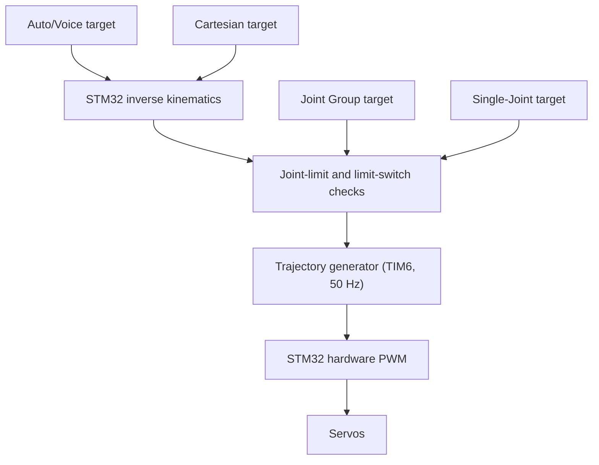

# Autonomous Robotic Arm - System Architecture (v3)

**Project:** Microcontroller Interfacing, Semester 1/2026  
**Main controller:** STM32 NUCLEO-F767ZI  
**Vision computer:** Raspberry Pi 4  
**Control method:** Direct STM32 hardware PWM  
**Updated:** one merged guide: the team's main guide + the STM32 core plan)  
**CubeMX details (pins, clock, DMA, interrupts):** `docs/core-config.md`

## 0. Changes in This Version

| Topic | Now |
|---|---|
| Raspberry Pi job | Camera only: finds the box (and, since 26 Oct, the operator's palm for `hand`) and reports its XYZ position in the robot-base frame |
| Voice, task state machine, IK | All on the STM32 |
| Pi link | Pi GPIO UART to STM32 USART6, 115200 8N1; message format v1 agreed (Section 12) |
| LCD | 2.8-inch ILI9341 **with touch** (the Lab 8 board): mode tabs, jog slider, jog queue with Undo, software STOP |
| Fine/Fast speed | KY-023 joystick press, in every manual mode |
| PWM | TIM3 CH1-2 + TIM4 CH1-4, verified pin map in `core-config.md` |
| Limit switches | 4 **optional** inputs reserved in CubeMX; switches not fitted yet |
| Servo-rail sense | 10 kΩ / 3.3 kΩ divider to the ADC |
| Holding an object | The arm **never** releases an object on a timer or as a side effect of `stop` |
| `stop` during a grasp | Accepted; the arm stops as soon as it is safe |
| Jog queue | Short and **bounded** (maximum item count and travel range) |
| After servo power returns | Targets stay frozen; inspect the arm and do a safe restart before new motion |
| Software | Bare-metal: one main loop plus interrupts, no RTOS |

## 1. Project Goal

The project is a six-axis robotic arm that can find and move a coloured box. It supports voice control and three manual control methods.

The system has four operating modes:

1. Auto/Voice Mode
2. Cartesian Mode
3. Joint Group Mode
4. Single-Joint Service Mode

The Raspberry Pi processes the RGB-D camera and sends object positions to the STM32. The STM32 handles voice recognition, the task state machine, inverse kinematics (IK), movement, manual controls, safety, the display, and servo PWM.

**Status (26 Oct 2026):** the voice model and the S0–S11 voice task are merged into `RoboticArmMain` and were tested on the board in dry-run mode with the real Pi (accepted words 75–99 %; `ProjectDevGuide/docs/voice-task.md` §4). The Pi bridge finds the four colour blocks and a hand with the D435, but sends camera-frame mm until the camera-to-robot calibration (`calib_T.npy`) is done. All six servos moved from a `RoboticArmMain` bench build (branch `test/servo-power-test`, never merged), and their unloaded calibration is measured. The IK solver and arm geometry are not written yet, so nothing moves the assembled arm.

## 2. Final Architecture

```text
Raspberry Pi 4
|- RGB-D camera
|- Object and colour detection
`- Depth and object XYZ in robot-base coordinates
              |
              | 3.3 V GPIO UART, TX/RX/GND, 115200 8N1
              v
STM32 NUCLEO-F767ZI - Main Controller
|- SAI1 + DMA audio input
|  `- 2 × INMP441 microphones, left and right channels, 16 kHz
|- TC-ResNet keyword model (X-CUBE-AI) and task state machine
|- Inverse kinematics and reachability checks
|- USART6 + DMA
|  `- Pi object positions and status
|
|- ADC1 + DMA (triggered by TIM2 at 1 kHz)
|  |- KY-023 joystick X
|  |- KY-023 joystick Y
|  `- Servo-rail voltage sense
|
|- TIM1 encoder mode
|  `- KY-040 rotary encoder rotation
|
|- EXTI interrupts
|  |- MODE button
|  |- Hold-to-Enable button
|  |- KY-040 encoder push button
|  |- KY-023 joystick push button (Fine/Fast)
|  |- Emergency-stop status
|  `- 4 × limit switches (optional, not fitted yet)
|
|- SPI5
|  `- ILI9341 2.8-inch TFT LCD (touch read by GPIO)
|
|- Mode state machine
|  |- Auto/Voice
|  |- Cartesian
|  |- Joint Group
|  `- Single-Joint Service
|
|- Safety and trajectory controller (TIM6, every 20 ms)
|  |- Input filtering
|  |- Joint-angle limits
|  |- Speed and acceleration limits
|  |- Communication timeout
|  `- Smooth movement generation
|
`- STM32 hardware PWM (TIM3 + TIM4, 50 Hz)
   |- Servo 1: base
   |- Servo 2: shoulder
   |- Servo 3: elbow
   |- Servo 4: wrist pitch
   |- Servo 5: wrist rotation
   `- Servo 6: gripper
              |
              v
     SN74AHCT244N DIP-20 buffer
              |
              v
          Six servos
```

The complete pin, timer, DMA and interrupt map is checked against ST's pin data and kept in `docs/core-config.md`. Do not change a pin without updating that file. USART3 (the ST-Link USB port) is kept for debugging only.

## 3. Responsibilities

| Device | Main responsibilities |
|---|---|
| Raspberry Pi 4 | Camera processing, depth measurement, and object XYZ in the robot-base frame |
| STM32F767ZI | Two-microphone voice recognition, task state machine, inverse kinematics, manual inputs, operating modes, safety checks, smooth trajectories, LCD and touch, UART, and six servo PWM signals |
| SN74AHCT244N | Changes the six STM32 PWM signals from 3.3 V logic to reliable 5 V logic |
| Servos | Move the six robot joints to the requested positions |

The STM32 is the main physical controller. The Pi reports what the camera sees; the STM32 decides whether and how to move. Camera-to-robot calibration on the Pi must convert the reported XYZ position into the robot-base frame.

## 4. Equipment

| Equipment | Quantity | Purpose |
|---|---:|---|
| STM32 NUCLEO-F767ZI | 1 | Main controller, safety checks and six PWM outputs |
| Raspberry Pi 4 | 1 | RGB-D camera processing |
| RGB-D camera | 1 | Object location and depth |
| INMP441 microphone | 2 | Left and right voice input to the STM32 |
| KY-023 joystick module | 1 | Two analogue axes for manual movement; push button for Fine/Fast speed |
| KY-040 rotary encoder module | 1 | Rotation and push-button input |
| ILI9341 2.8-inch SPI TFT LCD with touch (Lab 8 board) | 1 | Mode, target and safety status; touch controls |
| 12 mm normally-open momentary push button | 2 | One MODE button and one separate Hold-to-Enable button |
| 22 mm latching emergency-stop button, 1NO + 1NC | 1 | NC contact controls the servo-power disconnect; NO contact reports status to the STM32 |
| SN74AHCT244N DIP-20 | 1 | Buffers six STM32 PWM signals for the servos |
| 10 kΩ and 3.3 kΩ resistors; optional 100 nF capacitor | 1 set | Divides the 6 V servo rail for an STM32 ADC input |
| Limit switch with NC contact | 4, optional | Backup protection at the most important travel boundaries |

Power the KY-023, KY-040 and both INMP441 microphones from 3.3 V so their signals stay within the STM32 input limits. The two microphones share one SAI clock/data bus; the left mic's L/R pin goes to GND and the right mic's L/R pin goes to 3.3 V.

## 5. Pin Summary

| Feature | STM32 pins |
|---|---|
| Servos J1-J6 | PC6, PC7 (TIM3 CH1-2), PD12, PD13, PD14, PD15 (TIM4 CH1-4) |
| Microphones (SAI1) | PE4 WS, PE5 SCK, PE6 SD |
| LCD (SPI5) | PF7 SCK, PF8 MISO, PF9 MOSI, PC8 CS, PC9 DC, PC10 RESET, LED to 3.3 V |
| Touch | PC11 T_CLK, PC12 T_CS, PD2 T_DIN, PG2 T_DO, PG3 T_IRQ |
| KY-023 joystick | PA3 X, PC0 Y, PE15 SW |
| Servo-rail sense | PC3 |
| KY-040 encoder | PE9 CLK, PE11 DT, PE14 SW |
| MODE / Hold-to-Enable / E-stop status | PE10 / PE12 / PE7 |
| Limit switches 1-4 (optional) | PE8, PB11, PE0, PE2 |
| Pi UART (USART6) | PG14 TX to Pi GPIO15 (pin 10), PG9 RX from Pi GPIO14 (pin 8), GND |
| Debug (USART3) | ST-Link USB |

Buttons are wired pin → button → GND, using the STM32 internal pull-up (pressed = 0).

## 6. Operating Modes

### 6.1 Mode cycle

A short press of the MODE button changes between all four modes. The touch screen also has a tab for each mode. Both use the same safe mode-switching procedure (Section 9).

```text
AUTO/VOICE
    |
    v
CARTESIAN
    |
    v
JOINT GROUP
    |
    v
SINGLE-JOINT SERVICE
    |
    v
AUTO/VOICE
```

### 6.2 Single-Joint Service Mode

This mode is in the short-press cycle, but moving a joint still requires the Hold-to-Enable button. The STM32 must debounce MODE presses without blocking the safety system or PWM outputs.

## 7. Controls in Each Mode

| Mode | Joystick | Joystick press | Rotate encoder | Press encoder | Hold-to-Enable |
|---|---|---|---|---|---|
| Auto/Voice | Movement control disabled | - | Select display information | Cancel the active task | Not required |
| Cartesian | Move target X and Y | Fine/Fast | Move target Z | Open or close the gripper | Must be held |
| Joint Group | Control two joints | Fine/Fast | Select Group 1-3 | - (not used) | Must be held |
| Single-Joint Service | Move the selected joint | Fine/Fast | Select J1-J6 | Reset the selected target to the current commanded position | Must be held for movement |

The joystick press changes Fine/Fast only while the stick is near its centre, so an accidental press while pushing the stick does nothing.

### 7.1 Cartesian control

```text
Joystick X       -> Change target X
Joystick Y       -> Change target Y
Encoder rotation -> Change target Z
Encoder press    -> Open or close gripper
```

The STM32 calculates inverse kinematics from the XYZ target and rejects positions outside the arm's reachable workspace. It keeps the last reachable target and shows `OUT OF REACH` on the LCD. Cartesian Mode therefore works without the Pi.

### 7.2 Joint Group control

| Group | Joystick X | Joystick Y |
|---|---|---|
| Group 1 | J1 Base | J2 Shoulder |
| Group 2 | J3 Elbow | J4 Wrist pitch |
| Group 3 | J5 Wrist rotation | J6 Gripper |

Rotate the KY-040 to select a group. Press the joystick to change between Fine and Fast speed. Joint limits and the Hold-to-Enable button still apply.

All three manual modes work without the Pi. Joint Group and Single-Joint Service also remain available if the STM32 voice or IK functions fail.

## 8. Shared Motion Pipeline

Every mode must use the same safety and movement functions. A mode only creates a new target. It must not control PWM directly.



Auto/Voice and Cartesian targets need IK to become joint targets. Joint Group and Single-Joint targets already specify joints, so they enter the shared safety checks directly. Every mode then uses the same trajectory, speed limits, and emergency behaviour. Limit-switch checks are active only once the switches are fitted (Section 15.1).

## 9. Safe Mode Switching

Before the STM32 changes modes, it must:

1. Stop accepting movement input from the current mode.
2. Cancel the active voice task and any pending camera request when leaving Auto/Voice Mode.
3. Smoothly reduce the current movement speed.
4. Wait until the planned trajectory state becomes `IDLE`.
5. Require the Hold-to-Enable button to be released.
6. Check that the joystick is near its centre position.
7. Copy the current joint targets into the new mode.
8. Clear old joystick movement commands.
9. Change the mode.
10. Update the graphic LCD.

The STM32 stops its own trajectory and holds the current servo targets. The arm has no joint encoders, so the STM32 can confirm that its command has stopped changing, but it cannot prove that every physical joint has reached the exact angle.

## 10. Hold-to-Enable Button

The Hold-to-Enable button is required for movement in all manual modes.

```text
Button held     -> Manual movement is allowed
Button released -> Stop the manual trajectory and hold position
```

Releasing this button creates an EXTI interrupt so the STM32 reacts immediately.

The Hold-to-Enable button is not the same as the emergency stop:

- Hold-to-Enable stops a manual movement command.
- The emergency stop physically disconnects servo power.

## 11. Auto/Voice Mode

### 11.1 Flow

```text
Voice command ("pick" ... "red box")
      |
      v
STM32 recognises the words from two INMP441 microphones
      |
      v
STM32 asks the Pi to find the coloured box
      |
      v
Pi camera reports the box's XYZ position in the robot-base frame
      |
      v
STM32 shows the position on the LCD and waits for "yes"
      |
      v
STM32 calculates inverse kinematics and checks reachability
      |
      v
STM32 checks safety and joint limits
      |
      v
STM32 creates a smooth trajectory
      |
      v
STM32 hardware timers generate PWM
      |
      v
Robot arm moves the box
```

### 11.2 Vocabulary (21 command labels)

| Group | Labels |
|---|---|
| Start | `move`, `pick`, `grab` |
| Object | `blue box`, `green box`, `red box`, `black box` |
| Destination | `hand`, `station`, `base` |
| Jog | `forward`, `backward`, `left`, `right` |
| Edit | `undo` |
| Release | `place`, `drop` |
| Confirm | `yes`, `no` |
| Other | `home`, `stop` |

Each word is spoken on its own with a short pause. `station` and `base` are fixed positions set during calibration. `hand` is not fixed: after `yes`, the STM32 asks the Pi for the palm position at that moment (`FIND hand`, 26 Oct 2026). Finding the station with the camera instead of a fixed pose is a proposal only (Section 22).

### 11.3 Task state machine

| State | Meaning |
|---|---|
| S0 | Idle, waiting for a start word |
| S1 | Waiting for an object word |
| S2 | Object found, waiting for yes/no |
| S3 | Grasping the object |
| S4 | Holding the object |
| S5 | Destination chosen |
| S6 | Building the jog queue |
| S7 | Waiting for yes/no before placing |
| S8a | Executing the jog queue |
| S8b | Moving to the destination and placing |
| S9 | Releasing and returning home |
| S10 | Stopped |

```text
S0 --move/pick/grab--> S1 --blue/green/red/black box--> S2 --yes--> S3 (grasp) --> S4
S2 --no--> S1

S4 --hand/station/base--> S5 --> S7
S4 --place/drop--> S7
S4 --forward/backward/left/right--> S6

S6 --forward/backward/left/right--> S6   (add to the queue, up to the limit)
S6 --undo--> S6                         (remove the last item)
S6 --yes--> S8a (execute the queue) --> S4
S6 --no--> S4

S7 --yes--> S8b (move and place) --> S9 (release, go home) --> S0
S7 --no--> S4

stop while the arm is moving (S3, S8a, S8b, S9) --> S10 (stopped)
S10 --place/drop--> lower and open --> go home --> S0
S10 --home--> go home (gripper open) --> S0
```

Rules:

- `stop` is accepted in every state. While the arm is moving, including during a grasp, the STM32 performs a controlled stop as soon as it is safe and goes to S10. In a waiting state, `stop` cancels the pending choice.
- The gripper stays closed after `stop` while servo power is available. The arm **never** releases a held object on a timer or as a side effect of `stop`; only `place`/`drop` (and `home` from S10) open it.
- The object position is fixed when the user says `yes` in S2. It is not read again during that task.
- A placement needs a fresh `yes` (S7) before motion and gripper release. `no` cancels the pending choice.
- The jog queue only contains movements and runs exactly in the order spoken. It is **bounded**: a short maximum number of items (for example 10) and a maximum total travel. Both are set during implementation and validated on the real arm. The whole queued path is checked for reachability before `yes` runs it.
- Each queued item keeps the step size (cm) that was set on the touch-screen slider when it was added. The touch screen shows the queue and has an **Undo** button.
- `home` is blocked in Holding (S4) while the gripper is closed; the LCD shows `RELEASE FIRST`.
- If the arm holds an object for a long time without a command, the LCD shows a warning. It does not release the object by itself.
- A word that is not valid in the current state does nothing.
- Voice `stop` is a convenience. The hardware emergency stop is the safety function.

### 11.4 Voice hardware and model

- Two INMP441 microphones share one SAI1 bus as left and right channels at 16 kHz.
- The STM32 picks the microphone with the better signal-to-noise ratio for each word.
- The TC-ResNet CNN (X-CUBE-AI) checks the last one second of audio every 100 ms. On the test project it takes about 33 ms per run and about 38 KB of RAM.
- The model works on the board, but several words still need more board-recorded training data. Accuracy is measured with the team's board test set before each new model is flashed.

## 12. Raspberry Pi Link

The Pi link carries camera results, not servo angles.

| Item | Value |
|---|---|
| Wiring | Pi GPIO14 (TXD, pin 8) → STM32 PG9 (USART6 RX); Pi GPIO15 (RXD, pin 10) ← STM32 PG14 (USART6 TX); GND ↔ GND |
| Settings | 115200 8N1, 3.3 V on both sides (no level shifter) |
| Pi setup | `enable_uart=1` and `dtoverlay=disable-bt` in `config.txt`; remove the serial console from `cmdline.txt`; use `/dev/serial0` |
| Coordinates | Millimetres in the **robot-base frame** |
| Timeout | If the Pi does not answer in time, the STM32 cancels the task and shows `PI NOT RESPONDING` |

Message format v1 (agreed 21 October 2026; new messages can be added later):

```text
STM32 → Pi: FIND red_box
Pi → STM32: OBJ red_box 182 -45 30
Pi → STM32: NOTFOUND red_box
```

Object names follow the voice labels (`blue_box`, `green_box`, `red_box`, `black_box`). The Pi also answers `FIND hand` with the palm centre (`OBJ hand x y z`). Measured on the board: round trip 4–14 ms, timeout 3000 ms (`APP_PI_TIMEOUT_MS`). The camera-to-robot calibration is not done yet, so the Pi currently sends camera-frame mm. Details: `ProjectDevGuide/docs/inputs-and-pi-interface.md`.

The ST-Link USB cable may still provide programming, debugging or power, but it is not the Pi command link. The STM32 code uses one macro (`PI_UART`) for this link.

Because hobby servos do not report their positions, a completed trajectory means that the commanded motion time ended. It does not confirm the exact physical position.

## 13. PWM System

The STM32 uses hardware timers to generate stable servo PWM. Software delays must not generate the PWM signal.

| Joint | Pin | Timer channel |
|---|---|---|
| J1 Base | PC6 | TIM3 CH1 |
| J2 Shoulder | PC7 | TIM3 CH2 |
| J3 Elbow | PD12 | TIM4 CH1 |
| J4 Wrist pitch | PD13 | TIM4 CH2 |
| J5 Wrist rotation | PD14 | TIM4 CH3 |
| J6 Gripper | PD15 | TIM4 CH4 |

Both timers count in 1 µs steps with a 20 ms period (50 Hz). The compare value equals the pulse width in microseconds, and any pulse from 500 to 2500 µs is possible.

Each servo must be calibrated, because each one has its own pulse limits. The
measured unloaded values are in the
[canonical calibration table](../ProjectDevGuide/docs/servo-calibration.md).
For example, J1 (`MG996R-1`) measured:

```text
  0 deg ->  500 us
 90 deg -> 1460 us
180 deg -> 2430 us
```

The STM32 stores a calibration table for each servo and converts angles with two straight-line sections (0-90° and 90-180°). Each joint also has its own safe minimum and maximum angle. The installed limits, zero and home are still unmeasured; the firmware's `0/180/90` values are placeholders.

At power-up the PWM outputs send no pulse until the firmware has loaded its home pose (currently the 90° placeholder until installed calibration).

The trajectory controller updates target pulse widths smoothly. It never jumps from one large angle to another.

```text
Unsafe command:
20 degrees -> 120 degrees immediately

Smooth command:
20 -> 22 -> 24 -> ... -> 120 degrees
```

### 13.1 SN74AHCT244N Installation

> **Current wiring (24 Oct 2026): no buffer.** Until an SN74HCT244N or SN74AHCT244N arrives, each STM32 PWM pin goes through a 330 Ω series resistor straight to the servo signal wire, with a common ground. All six servos move this way. Do not use the SN74HC244N (no "T") with a diode on VCC; that stage was built and failed. See `ProjectDevGuide/docs/core-config.md` §11.

The SN74AHCT244N is not built into the STM32 NUCLEO-F767ZI. It is a separate 20-pin DIP integrated circuit. The STM32 GPIO pins generate 3.3 V PWM signals, while this buffer changes them into reliable 5 V logic signals for the servos.

For early testing, place the DIP-20 chip across the centre gap of a breadboard. This does not require soldering. For the final robot, solder a 20-pin DIP socket onto perfboard and insert the chip into the socket after soldering. The socket makes the chip easier to replace and prevents soldering heat from reaching it.

```text
STM32 PWM outputs at 3.3 V
              |
              v
      SN74AHCT244N buffer
              |
              v
       5 V PWM logic signals
              |
              v
       Six servo signal wires
```

### 13.2 SN74AHCT244N Wiring

| Chip pin | Signal | Connection |
|---|---|---|
| 20 | VCC | Regulated 5.1 V logic rail |
| 10 | GND | Common system ground |
| 1 | `/1OE` | Ground to enable outputs 1-4 |
| 19 | `/2OE` | Ground to enable outputs 5-8 |
| 2 -> 18 | `1A1 -> 1Y1` | PC6 (J1) -> Servo 1 signal |
| 4 -> 16 | `1A2 -> 1Y2` | PC7 (J2) -> Servo 2 signal |
| 6 -> 14 | `1A3 -> 1Y3` | PD12 (J3) -> Servo 3 signal |
| 8 -> 12 | `1A4 -> 1Y4` | PD13 (J4) -> Servo 4 signal |
| 11 -> 9 | `2A1 -> 2Y1` | PD14 (J5) -> Servo 5 signal |
| 13 -> 7 | `2A2 -> 2Y2` | PD15 (J6) -> Servo 6 signal |
| 15 and 17 | Unused inputs | Connect to ground so they do not float |
| 5 and 3 | Unused outputs | Leave unconnected |

Connect a 100 nF ceramic capacitor directly between pin 20 and pin 10, as close to the chip as possible. Connect the STM32 ground, buffer ground, and servo ground together so that every PWM signal has the same voltage reference.

> **Important:** Power the SN74AHCT244N from the regulated 5.1 V logic rail.
> Never connect its VCC pin to the 6.0 V servo rail. The servo current must also
> never pass through the buffer; only the servo signal wires connect to its
> outputs.

## 14. Power Architecture

Servo power and logic power use separate regulated paths, but all devices share a common signal ground.

```text
12 V adapter or 3S LiPo
          |
          +--> Fuse --> E-stop relay --> 20 A buck at 6.0 V
          |                                  |
          |                         Servo distribution block
          |                                  +--> Six servo power inputs
          |                                  `--> 10 k / 3.3 k divider --> STM32 PC3 (ADC)
          |
          `--> 5 A buck at 5.1 V --> Raspberry Pi, buffer and logic
                                          |
                                          `--> Pi USB port --> Nucleo ST-Link USB (power)
```

For every servo:

```text
STM32 PWM through buffer -> Signal wire
6.0 V distribution      -> Red power wire
Common ground            -> Black or brown ground wire
```

Do not send servo current through the STM32 board or the logic buffer.

In the final robot no laptop is connected. Power the Nucleo from the Pi's USB port (this also lets the Pi reflash the STM32) or from the 5.1 V rail through the E5V pin.

For the first development tests, use the 12 V wall adapter. Add battery operation only after the complete arm works reliably on the bench.

## 15. Emergency Stop

The emergency stop must work through both hardware and software:

```text
E-stop pressed
   |- Hardware: NC contact releases the relay, which disconnects the 6 V servo rail
   |- Software: NO contact -> EXTI (PE7) informs the STM32
   `- Software: servo-rail voltage on PC3 drops to 0 V
```

The power system should include:

- A 22 mm latching emergency-stop button with one normally-closed (NC) and one normally-open (NO) contact
- A fuse close to the battery or source
- A suitable relay or DC power switch
- A transistor or MOSFET relay driver
- A flyback diode across the relay coil
- An EXTI status connection to the STM32
- A servo-rail voltage divider to the STM32 ADC

Software stopping alone is not enough because software may freeze. Use the NC contact in the low-current relay-control circuit so pressing the button releases the relay and removes servo power. Use the NO contact for the STM32 status input. Do not put the servo current through the button contacts; the relay or DC power switch carries it.

### 15.1 Limit switches (optional)

Four inputs are reserved for limit switches at the arm's most important travel boundaries (PE8, PB11, PE0, PE2). The switches are not fitted yet; the CubeMX configuration already includes the pins, so adding them later needs no `.ioc` change.

- Wire each switch's **NC contact between the pin and GND**. Normal = 0; triggered **or a broken wire** = 1, so a fault is treated as triggered.
- An unconnected pin also reads 1, so the firmware ignores these inputs until `APP_USE_LIMIT_SWITCHES` is set to 1.
- If a switch is triggered, the STM32 blocks motion farther into that boundary while allowing a safe move away.
- The mounting points require mechanical testing.
- Limit switches are a backup to the software angle limits, not a replacement for the hardware emergency stop.

### 15.2 Servo-rail ADC sense

This measures whether power reaches the **6 V servo distribution block**, after the servo buck and the emergency-stop relay. It is a diagnostic input, not part of the hardware stop circuit.

```text
6 V distribution -> 10 kΩ -> PC3 (ADC) -> 3.3 kΩ -> common ground
                              |
                              `-> 100 nF -> ground (optional)
```

The divider gives about **1.49 V at 6 V** and **2.98 V at 12 V** at the ADC pin. 12 V is a fault example, not an acceptable servo supply. Check the voltage with a multimeter before connecting PC3.

The E-stop NO contact only shows the button position. The rail sense shows whether the servos really have power, and also detects a blown fuse, a failed buck converter or a loose power wire.

When the rail drops, the STM32:

1. Freezes all joint targets at their current commanded values, so nothing jumps when power returns.
2. Stops the trajectory and any voice task.
3. Shows `SERVO POWER OFF` on the LCD.

After power returns, the STM32 does not assume the servos stayed at their last commanded positions. The arm must be inspected and a safe restart confirmed before any new motion.

The emergency-stop relay must disconnect servo power even if the STM32 or the ADC fails.

## 16. Graphic LCD and Touch Screen

The LCD is the same 2.8-inch ILI9341 board used in Lab 8 (320 × 240, SPI, with touch). It shows only useful operating information.

The touch screen provides:

- Mode tabs
- The jog step-size slider (cm) for voice jog commands
- The jog queue display with an **Undo** button
- A software **STOP** button. This is a convenience only; it is not the safety stop

Example for Joint Group Mode:

```text
MODE: JOINT GROUP
Group: 2

X: J3 ELBOW
Y: J4 WRIST PITCH
Speed: FINE
```

Example for Cartesian Mode:

```text
MODE: CARTESIAN

X: 120 mm
Y: 80 mm
Z: 150 mm
Gripper: OPEN
```

Example for Single-Joint Service Mode:

```text
MODE: SINGLE-JOINT SERVICE

Joint: J2 SHOULDER
Target: 65 deg
Enable: RELEASED
```

Example for Auto/Voice Mode while building a jog queue:

```text
MODE: VOICE         HOLDING red box
Step: 2 cm  [------o----]

Queue (3/10): FORWARD 2, LEFT 2, LEFT 2   [UNDO]
Say "yes" to run, "no" to cancel
```

The LCD also shows:

- Pi connection status
- E-stop and servo-power status
- Limit-switch status (once fitted)
- The last recognised voice word
- The current task
- Error messages, including:
  - `OUT OF REACH`: the Cartesian or voice target cannot be reached
  - `PI NOT RESPONDING`: the Pi did not answer in time
  - `SERVO POWER OFF`: the servo rail has dropped; targets are frozen
  - `RELEASE FIRST`: `home` while holding an object

The LCD redraws only the parts of the screen that changed. A full redraw in every loop would block the voice system.

## 17. Input Filtering

The joystick ADC values will contain small changes even when the joystick is not moving. The STM32 uses:

- ADC scanning with DMA, triggered at 1 kHz
- An average or exponential filter
- A centre dead zone
- A small movement deadband

Example:

```text
Raw joystick value changes slightly
2045 -> 2049 -> 2042 -> 2047

Filtered result
2046 -> no movement
```

The dead zone prevents the arm from slowly moving when the joystick is released.

The KY-040's mechanical contacts can also bounce. The encoder timer uses its hardware input filter, and every push button is debounced in software, so one physical detent or press produces one action.

## 18. Software Structure

The firmware is bare-metal: one main loop plus interrupts. There is no RTOS.

| Runs in | Job |
|---|---|
| SAI DMA interrupt (every 10 ms) | Collect microphone audio |
| TIM6 interrupt (every 20 ms) | Read inputs, safety checks, trajectory step, update the six PWM outputs |
| EXTI interrupts | Buttons, E-stop status, limit switches |
| UART interrupt | Mark a Pi message as received |
| Main loop | Voice CNN, task state machine, IK, mode logic, Pi messages, touch, LCD |

Rule for everyone: no job in the main loop may block for more than about 100 ms, or audio is lost.

All members share one STM32CubeMX configuration (`.ioc`). Only the `.ioc` owner changes it. Each feature lives in its own folder under `App/`. See `docs/core-config.md`.

## 19. Course Requirement Check

| Course requirement | Project implementation | Status |
|---|---|---|
| STM32, HAL, and STM32CubeIDE | STM32F767ZI is the main controller | Satisfied |
| Interrupts from two modules | UART, EXTI, timer and DMA interrupts | Satisfied |
| ADC | Joystick X and Y; servo-rail sense | Satisfied |
| PWM | Six STM32 hardware PWM outputs | Satisfied |
| Graphic LCD | ILI9341 2.8-inch SPI TFT LCD with touch | Satisfied |
| At least 4-6 features | Four control modes, voice, vision, IK, LCD/touch and safety functions | Satisfied |

This architecture uses all three requested modules: ADC, PWM, and graphic LCD.

## 20. Main Features

1. **Auto/Voice:** Say fixed commands, such as "pick" ... "red box" ... "yes". The STM32 recognises them using two microphones, asks the Pi camera for the box's position, calculates the joint angles and moves the arm.
2. **Cartesian:** Use the KY-023 joystick to move the target in X and Y, and turn the KY-040 to change Z. The STM32 calculates the joint angles, so this mode works without the Pi.
3. **Joint Group:** Move two selected joints with the KY-023 joystick. Turn the KY-040 to select one of three joint groups.
4. **Single-Joint Service:** Test one joint at a time. Turn the KY-040 to select J1-J6, then move that joint with the joystick.
5. **On-device voice recognition:** A CNN on the STM32 recognises 21 command words from two microphones.
6. **LCD, touch and safety:** The 2.8-inch touch LCD shows the mode and status and provides mode tabs, the jog queue and a software STOP button. Manual movement requires Hold-to-Enable, servo power is monitored, optional limit switches protect travel boundaries, and the emergency stop disconnects servo power.

## 21. Development Priority

1. Build the shared STM32CubeMX configuration (`core-config.md`) and push it to the repository.
2. Test one servo with STM32 hardware PWM.
3. Test all six PWM outputs without attaching the arm links.
4. Read and filter the KY-023 joystick and KY-040 encoder.
5. Implement Joint Group Mode with Hold-to-Enable.
6. Implement Single-Joint Service Mode and calibrate every servo.
7. Add the short-press MODE cycle.
8. Add the ILI9341 graphic LCD and touch input (mode tabs first).
9. Implement and test STM32 inverse kinematics and Cartesian Mode with measured arm geometry.
10. Test Pi GPIO UART communication and camera-to-robot calibration.
11. Add the camera object search and depth calculation on the Pi.
12. Merge the voice system into the shared project and check memory use, latency and accuracy on the board.
13. Install and test the hardware emergency stop, the servo-rail sense and (if fitted) the limit switches before any autonomous motion.
14. Test the complete autonomous sequence.
15. Add battery operation only if enough time remains.

## 22. Still Open

| Item | Owner |
|---|---|
| Arm geometry for IK (joint order, link lengths, zero pose) | Mechanical / IK member |
| Installed servo calibration (safe range, zero, home) after assembly; unit-to-joint map already confirmed J1-J6 = units 1-6 | Servo / motion member |
| Whether to fit the 4 limit switches, and where | Mechanical member |
| Jog queue limits (item count, total travel) | Voice / motion members, on the real arm |
| Camera-to-robot calibration (`calib_T.npy`); the Pi timeout is set to 3000 ms | Pi member |
| Destination positions for station / base (`hand` uses the live palm position) | Set during calibration |
| **Proposal:** find the station with the camera instead of a fixed pose (`FIND station`; see `ProjectDevGuide/docs/inputs-and-pi-interface.md` §5) | Pi member + core owner, if the team agrees |
| SN74HCT244N or SN74AHCT244N buffer (servos run direct through 330 Ω until it arrives) | Hardware member |
| Voice model accuracy on the board (75–99 % for accepted words in the 25 Oct dry run) | Voice member |

The Motion 2350 Pro and PCA9685 are not part of the final architecture. They may be kept only as backup hardware if direct STM32 PWM cannot be completed.
